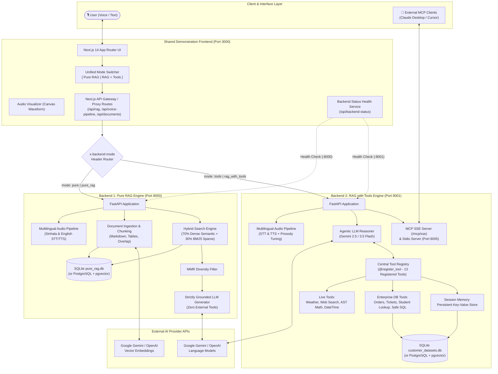
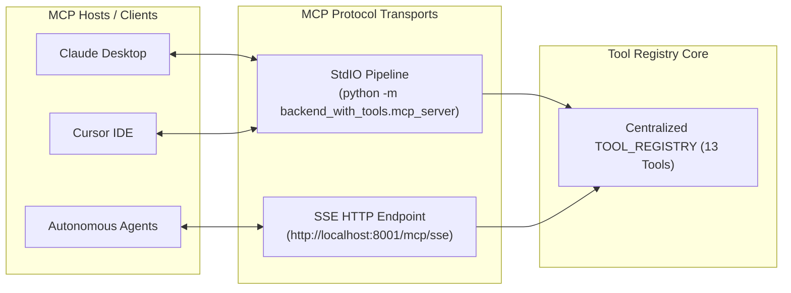
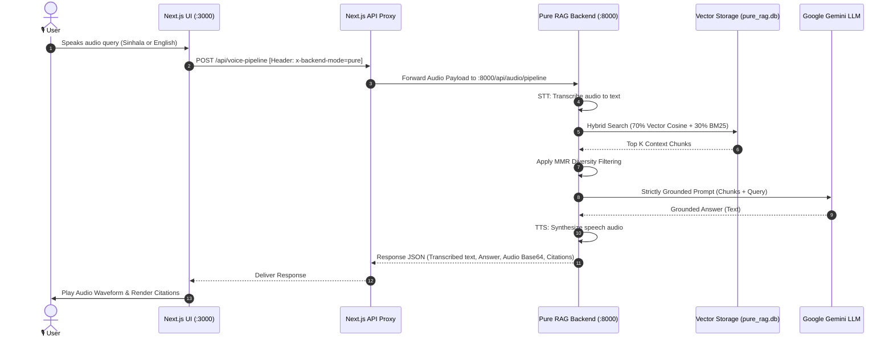
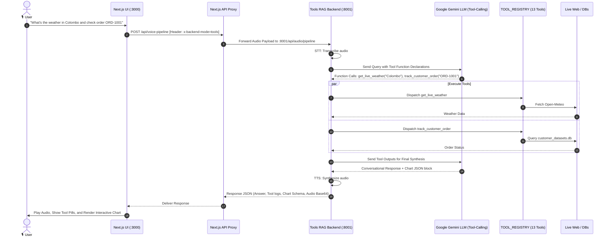

# Voice-RAG Bot — System Architecture Specification

## 1. Executive Summary

**Voice-RAG Bot** is an enterprise-grade, voice-enabled Retrieval-Augmented Generation (Voice-RAG) platform supporting natural spoken Sinhala (සිංහල) and English. 

The system employs a **Decoupled Dual-Backend Architecture** orchestrated under a unified **Next.js 14 Demonstration Frontend**. This architecture physically separates:
1. **Pure Document RAG (`backend_pure_rag` - Port 8000)**: Enforces mathematical grounding, zero external tool calls, and strict citation from verified knowledge base documents.
2. **Tool-Augmented Agentic RAG (`backend_with_tools` - Port 8001)**: Implements dynamic function-calling with 13 real-time tools, multi-database Text-to-SQL querying, session memories, and native Model Context Protocol (MCP) server compliance.

---

## 2. High-Level System Architecture



---

## 3. Core Component Breakdown

### 3.1. Shared Next.js Frontend (Port 3000)

The presentation tier is built with **Next.js 14**, **React 18**, and **TailwindCSS**, offering a unified interface for real-time speech and text interaction:

* **Unified Mode Switcher**: Toggles between `pure` and `tools` backends on the fly. Dynamically shifts theme accents, example prompts, and active capabilities without reloading the page.
* **Header-Based Dynamic Dispatching**: Client API calls forward the selected mode via HTTP request header `x-backend-mode: pure` or `x-backend-mode: tools`. Next.js proxy endpoints (`/api/rag`, `/api/voice-pipeline`, `/api/documents`) route payloads to either `http://localhost:8000` or `http://localhost:8001`.
* **Health & Status Dashboard**: Polls `/api/backend-status`, checking both services simultaneously and indicating real-time online/offline states.
* **Voice Waveform Visualizer**: Captures microphone streams and renders real-time frequency curves on an HTML5 Canvas.
* **Interactive Data & Chart Renderer**: Parsers detect structured chart metadata emitted by the tool-augmented backend and render interactive bar, line, and pie charts using **Recharts**.
* **Context Transparency Drawer**: Exposes exact retrieved document passages, similarity scores, and tool outputs used to generate responses.

---

### 3.2. Backend 1: Pure RAG Engine (Port 8000)

Located in [`backend_pure_rag/`](file:///d:/VoiceRagBot/Voice-Rag-bot/backend_pure_rag/), this service is dedicated to unadulterated document reasoning.

```
                           ┌────────────────────────────────────────┐
                           │        backend_pure_rag (8000)         │
                           └──────────────────┬─────────────────────┘
                                              │
                   ┌──────────────────────────┴──────────────────────────┐
                   ▼                                                     ▼
    ┌─────────────────────────────┐                       ┌─────────────────────────────┐
    │     Document Ingestion      │                       │     Hybrid Retrieval        │
    ├─────────────────────────────┤                       ├─────────────────────────────┤
    │ • PDF, DOCX, TXT Parsing    │                       │ • 70% Dense Cosine Search   │
    │ • Heading & Table Chunking  │                       │ • 30% BM25 Sparse Keyword   │
    │ • Batch Vector Embeddings   │                       │ • MMR Diversity Filter      │
    │ • Storage in pure_rag.db    │                       │ • Strict Grounding Prompt   │
    └─────────────────────────────┘                       └─────────────────────────────┘
```

#### Key Architecture Principles:
* **Zero External Tools**: Does not register math evaluators, web searches, SQL executors, or memory modules.
* **Strict Anti-Hallucination Grounding**: The system prompt strictly prohibits inferring facts beyond provided document chunks. If the answer is not present, the model explicitly acknowledges the limitation.
* **Hybrid Retrieval (Dense + Sparse)**: Combines semantic vector similarity (Cosine Distance) with lexical matching (BM25) to accurately surface domain terminology, acronyms, and product IDs.
* **Maximal Marginal Relevance (MMR)**: Re-ranks results to eliminate redundant text blocks from repetitive document templates.
* **Database Independence**: Operates out-of-the-box using local SQLite (`pure_rag.db`) with fallback vector math, and automatically upgrades to PostgreSQL with `pgvector` when `DATABASE_URL` is configured.

---

### 3.3. Backend 2: RAG with Tools Engine (Port 8001)

Located in [`backend_with_tools/`](file:///d:/VoiceRagBot/Voice-Rag-bot/backend_with_tools/), this service provides an agentic reasoning environment capable of live environmental interaction.

#### Central Tool Architecture (`backend_with_tools/tools/`)
The tool subsystem is organized into isolated modules registered into a centralized dictionary via the `@register_tool` decorator:

| Tool Identifier | Module File | Description | Security / Guardrails |
| :--- | :--- | :--- | :--- |
| `get_live_weather` | `weather.py` | Real-time weather and forecasts via Open-Meteo API | Free public API, no key required |
| `web_search` | `web_search.py` | Real-time internet search via DuckDuckGo | Read-only web indexing |
| `get_current_datetime`| `datetime_tool.py` | Accurate date, time, and timezone calculations | Local Python `datetime` / `zoneinfo` |
| `calculate_expression`| `calculator.py` | Mathematical calculations | AST-parsed safe arithmetic (No `eval()`) |
| `track_customer_order`| `order_tracking.py` | Order fulfillment, items, tracking IDs, statuses | Pre-seeded SQLite lookup |
| `track_support_ticket`| `ticket_tracking.py`| Customer issue resolution, priorities, notes | Pre-seeded SQLite lookup |
| `lookup_student` | `student_lookup.py` | Student academic records, department, GPA | Pre-seeded SQLite lookup |
| `execute_sql` | `sql_executor.py` | Read-only SQL query runner across databases | Strict AST blocking of `DROP/INSERT/UPDATE` |
| `list_databases` | `database_inspection.py`| Enumerate connected SQLite/Postgres databases | Metadata schema discovery |
| `get_database_schema`| `database_inspection.py`| Table column definitions and types | Read-only SQLite PRAGMA inspection |
| `get_session_memories`| `session_memory.py` | Retrieve stored session facts and preferences | User-keyed key-value storage |
| `save_session_memory` | `session_memory.py` | Persist key facts across conversations | Validated schema insertion |
| `search_knowledge_base`| `knowledge_search.py`| Internal vector search on uploaded documents | Scoped document search tool |

---

### 3.4. Model Context Protocol (MCP) Integration

The tool backend exposes an enterprise MCP Server using the official `mcp` SDK:
1. **Stdio Server (`backend_with_tools.mcp_server`)**: Connects to desktop applications like **Claude Desktop** and **Cursor** over standard I/O streams.
2. **SSE Server (`/mcp/sse` on Port 8001 or Standalone Port 8005)**: Allows remote agents and web microservices to consume tools via Server-Sent Events.



---

## 4. End-to-End Sequence Workflows

### 4.1. Voice Query Workflow (Pure RAG Mode)



---

### 4.2. Voice Query Workflow (Tool-Augmented RAG Mode)



---

## 5. Network, Port, and Protocol Matrix

| Service | Port | Host Address | Protocols | Primary Responsibilities |
| :--- | :--- | :--- | :--- | :--- |
| **Next.js Frontend** | `3000` | `http://localhost:3000` | HTTP / WebSocket | UI, audio recording, mode switcher, chart render |
| **Pure RAG Backend** | `8000` | `http://localhost:8000` | HTTP / REST | Document ingestion, vector hybrid search, STT/TTS |
| **RAG with Tools Backend** | `8001` | `http://localhost:8001` | HTTP / REST / SSE | Agent reasoning, 13 live tools, DB SQL, STT/TTS |
| **MCP SSE Endpoint** | `8001` | `http://localhost:8001/mcp/sse` | HTTP SSE | Model Context Protocol for web clients |
| **Standalone MCP Server** | `8005` | `http://localhost:8005/sse` | HTTP SSE | Standalone SSE server for external tool consumers |
| **PostgreSQL + pgvector** | `5432` / `5433` | `localhost:5432` | TCP / Postgres Wire | High-speed enterprise vector storage (Docker) |

---

## 6. Directory Structure & Code Mapping

```text
Voice-Rag-bot/
├── ARCHITECTURE.md                  # This architecture specification
├── README.md                        # Project documentation and getting started
├── docker-compose.yml               # Multi-container service definitions
├── package.json                     # Frontend scripts and Node dependencies
├── start_all.ps1                    # One-click Windows PowerShell orchestrator
├── start_all.sh                     # Bash orchestrator for Linux/macOS
│
├── backend_pure_rag/                # 🔹 BACKEND 1: PURE RAG (Port 8000)
│   ├── main.py                      # FastAPI app instance, CORS, lifespan, /health
│   ├── config.py                    # Environment variables, port (8000), SQLite config
│   ├── db.py                        # pure_rag.db schema & pgvector connection
│   ├── document_parser.py           # PDF, DOCX, TXT extraction and chunking
│   ├── rag_service.py               # Hybrid search, MMR filter, strict LLM caller
│   ├── audio_service.py             # Multilingual STT & TTS pipeline
│   └── routers/
│       ├── documents.py             # Document upload, listing, deletion
│       ├── rag.py                   # Pure query endpoint (/api/rag)
│       ├── audio.py                 # Full voice-in voice-out endpoint (/api/audio)
│       └── history.py               # Conversation history persistence
│
├── backend_with_tools/              # 🔸 BACKEND 2: RAG WITH TOOLS (Port 8001)
│   ├── main.py                      # FastAPI app instance, MCP mount, /health
│   ├── config.py                    # Environment variables, port (8001), DB config
│   ├── db.py                        # customer_datasets.db schema & student seeder
│   ├── db_query_service.py          # Read-only SQL executor & injection prevention
│   ├── document_parser.py           # Document extraction & embeddings
│   ├── rag_service.py               # Tool-augmented reasoning & Gemini function calling
│   ├── audio_service.py             # Multilingual STT & TTS with prosody tuning
│   ├── mcp_server.py                # Official Model Context Protocol (MCP) server
│   ├── tools/                       # 🛠️ Modular Tool Architecture
│   │   ├── __init__.py              # Auto-loader and registry aggregator
│   │   ├── base.py                  # @register_tool decorator & registry definition
│   │   ├── weather.py               # get_live_weather
│   │   ├── web_search.py            # web_search
│   │   ├── datetime_tool.py         # get_current_datetime
│   │   ├── calculator.py            # calculate_expression
│   │   ├── order_tracking.py        # track_customer_order
│   │   ├── ticket_tracking.py       # track_support_ticket
│   │   ├── student_lookup.py        # lookup_student
│   │   ├── sql_executor.py          # execute_sql
│   │   ├── database_inspection.py   # list_databases, get_database_schema
│   │   ├── session_memory.py        # get_session_memories, save_session_memory
│   │   └── knowledge_search.py      # search_knowledge_base
│   └── routers/
│       ├── documents.py             # Document management
│       ├── rag.py                   # Tool-augmented query endpoint (/api/rag)
│       ├── audio.py                 # Voice pipeline (/api/audio/pipeline)
│       ├── databases.py             # Database discovery & safe query execution
│       ├── students.py              # Student record endpoints
│       ├── memory.py                # Session memories endpoint
│       └── history.py               # Chat history with tool audit logs
│
└── src/                             # 💻 SHARED DEMONSTRATION FRONTEND (Port 3000)
    ├── app/
    │   ├── api/                     # Header-based Proxy Gateways
    │   │   ├── backend-status/      # Health check proxy for :8000 and :8001
    │   │   ├── rag/                 # RAG query proxy
    │   │   ├── voice-pipeline/      # Audio pipeline proxy
    │   │   ├── documents/           # Document management proxy
    │   │   ├── databases/           # Database tools proxy
    │   │   ├── students/            # Student tools proxy
    │   │   └── memory/              # Memory tools proxy
    │   ├── layout.tsx               # Root layout & Google Fonts
    │   └── page.tsx                 # Dynamic dashboard with unified switcher
    ├── components/
    │   ├── VoiceInterface.tsx       # Microphone handler, recording & playback
    │   ├── AudioVisualizer.tsx      # Canvas-based real-time audio wave
    │   ├── DynamicChart.tsx         # Recharts dynamic visualization component
    │   ├── ContextDrawer.tsx        # Transparency drawer for document chunks & tools
    │   ├── DocumentManager.tsx      # Knowledge base upload & management
    │   └── SettingsModal.tsx        # Voice selection, persona, and API key config
    └── lib/
        └── backend-config.ts        # getBackendUrl() helper parsing x-backend-mode
```

---

## 7. Security and Reliability Guarantees

1. **SQL Injection Mitigation**:
   - The `execute_sql` tool enforces read-only operations via AST parsing and regex checks, blocking statements like `DROP`, `DELETE`, `UPDATE`, `INSERT`, `ALTER`, `TRUNCATE`, and administrative pragmas.
2. **Safe Mathematical Evaluation**:
   - The `calculate_expression` tool inspects arithmetic expressions through Python's `ast` module, restricting execution to standard arithmetic nodes (`Add`, `Sub`, `Mult`, `Div`, `Pow`, `Mod`) and banning arbitrary code execution (`eval`, `exec`).
3. **Decoupled Failure Isolation**:
   - If one backend experiences high traffic or crashes, the other backend remains completely unaffected due to independent process boundaries and dedicated database files (`pure_rag.db` vs. `customer_datasets.db`).
4. **Environment Isolation**:
   - Both backends load configurations independently from root `.env` and `.env.local` files, with separate port variables (`PURE_RAG_PORT=8000` and `TOOLS_RAG_PORT=8001`).
